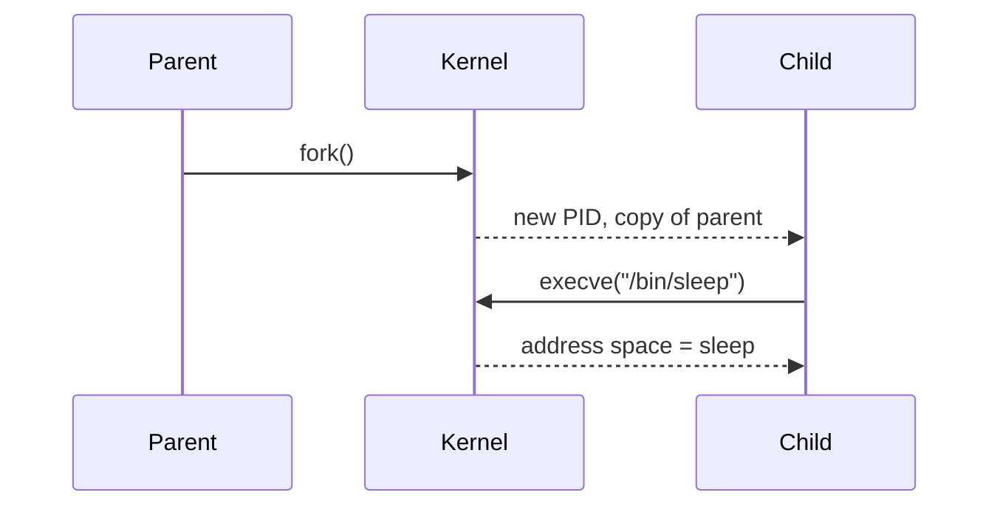

# 01 — Linux processes: the real unit of work

## ELI5 hook

Imagine a kitchen. Recipes are *programs* (files of instructions). A cook following a recipe right now is a *process*. Kubernetes does not schedule “containers” in the abstract — it schedules **processes**, wrapped in isolation and resource budgets.

## Mental model

| Word | Meaning |
|------|---------|
| **Program** | Bytes on disk (an executable + libraries) |
| **Process** | A running instance: memory, open files, threads, a PID |
| **PID** | Process ID — the kernel’s handle for that instance |
| **fork / exec** | Clone yourself, then replace your code with a new program |

A “container” is **not** a mini-VM. It is one or more processes that:

1. Share the **same kernel** as the host
2. Live behind **namespaces** (what they can see)
3. Sit in a **cgroup** (what they can spend)

If you remember only one sentence from this course: **containers are processes with lies about the world and a budget.**

## What Linux does

### Seeing processes

```bash
ps aux | head
# or
ps -eo pid,ppid,user,cmd --sort=pid | head -20
```

Every process has a parent (`PPID`). The tree starts at PID 1 (`init` / `systemd` on a normal host; `pause` or your entrypoint inside a container’s PID namespace — more in chapter 02).

### fork and exec (the birth story)



1. `fork()` — kernel clones the process (cheap with copy-on-write)
2. `execve()` — same PID, new program image

Container runtimes (`runc`, etc.) ultimately do variations of: set up namespaces → set cgroup → `exec` your entrypoint.

### Threads vs processes

Threads share an address space; processes usually do not. From the kernel’s view, both are “tasks.” For this course: **pods and containers manage process trees**, not “JVM threads” as first-class objects.

### /proc — the process filesystem

```bash
ls /proc/self
cat /proc/self/status | head
readlink /proc/self/exe
ls /proc/self/ns   # namespace inodes — chapter 02
```

`/proc` is how tools (and Kubernetes agents) inspect the live machine. When debugging a node, you are often reading `/proc` and cgroup files, not API objects.

## How Kubernetes uses it

| K8s idea | Linux reality |
|----------|---------------|
| Container | Process tree in namespaces + cgroup |
| Pod | Group of containers sharing some namespaces |
| `command` / `args` | `exec` argv of the entrypoint |
| CrashLoopBackOff | Process exited; kubelet restarts it |
| `kubectl exec` | Attach to a running process’s namespaces |

The API talks about Pods and Containers. The node talks about **PIDs**, file descriptors, and mounts.

## Lab — watch a process be born

```bash
# Terminal A: watch the tree
watch -n1 'ps -ef | grep -E "sleep|PID" | grep -v grep'

# Terminal B: start a short-lived process
sleep 30 &
echo "PID=$!"
cat /proc/$!/cmdline | tr '\0' ' '; echo
ls -l /proc/$!/fd | head
```

Optional — same idea with Docker/podman (still just processes):

```bash
docker run --rm -d --name sleepy alpine sleep 60
docker top sleepy
# Note the host PID, then:
ps -p $(docker inspect -f '{{.State.Pid}}' sleepy) -o pid,ppid,cmd
docker stop sleepy
```

## Gotchas

- **“Containers isolate like VMs”** — No. Same kernel. Kernel bugs and misconfig are shared fate.
- **PID 1 inside a container** — Your app may *be* PID 1. PID 1 has special signal/reap duties; zombie children and unreaped orphans are a classic footgun. That’s why many images use `tini` or similar.
- **`kubectl logs` ≠ magic** — stdout/stderr of the process, collected by the runtime.
- **Killing a container** — Sending SIGTERM/SIGKILL to the process tree, with a grace period.

## Checkpoint

You should be able to say out loud: *A container is a process (tree) with restricted view and a resource budget, sharing the host kernel.*

Next: [02 — Namespaces](02-namespaces.md) (the walls).

---

**Quiz arc:** after chapters 01–04 → [`/quizzes/k8s-linux-foundations/`](/quizzes/k8s-linux-foundations/)
