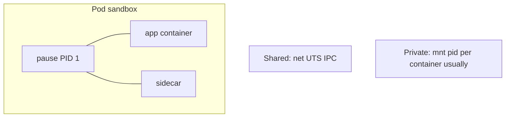

# 02 — Namespaces: walls, not VMs

## ELI5 hook

Imagine open-plan offices with **frosted glass walls**. Everyone still shares the building’s electricity and plumbing (the kernel), but each room has its own furniture list, phone system, and nameplate. Linux **namespaces** are those rooms: they change *what a process can see*, not what hardware it runs on.

## Mental model

A namespace is a **scoped view** of a global kernel resource. Join a namespace → you see a private list. Leave it (or look from the host) → you see another list.

| Namespace | What it remaps | ELI5 |
|-----------|----------------|------|
| **pid** | Process IDs | “In this room, I am PID 1” |
| **mnt** | Mount table | “My `/` is not your `/`” |
| **net** | Network stack | “My eth0, my iptables, my ports” |
| **uts** | Hostname / NIS domain | “My hostname sticker” |
| **ipc** | SysV IPC, POSIX MQ | “My shared-memory whiteboard” |
| **user** | UIDs/GIDs mapping | “UID 0 inside ≠ root outside” |
| **cgroup** | cgroup root view | “My view of the budget tree” |
| **time** | Clock offsets (newer kernels) | “My slightly skewed clock” |

**Namespaces ≠ security by themselves.** They are isolation of *visibility*. Combine with cgroups, capabilities, seccomp, and LSM for defense in depth (chapters 03–04).

## What Linux does

Each process has file descriptors under `/proc/<pid>/ns/` pointing at namespace inodes. Same inode number ⇒ same namespace.

```bash
ls -l /proc/self/ns
readlink /proc/$$/ns/pid
readlink /proc/1/ns/pid   # usually different from yours on a normal host
```

### Creating walls: `unshare`

```bash
# New UTS + mount namespace; become "alone" for hostname + mounts
sudo unshare --uts --mount /bin/bash
hostname fake-pod
hostname   # fake-pod
# In another terminal on the host, hostname is unchanged
```

### Entering walls: `nsenter`

```bash
# Enter another process's network namespace (needs privileges)
sudo nsenter --target <pid> --net ip addr
```

This is exactly what debugging tools and CNI plugins do conceptually: **hold a handle to a netns and configure it**.

### PID namespaces and the pause container

In a new PID namespace, the first process becomes PID 1. When PID 1 dies, the kernel kills the rest of the namespace. Kubernetes pods keep a tiny **`pause`** (or equivalent) process as PID 1 so the sandbox stays alive while app containers come and go.

## How Kubernetes uses it



Typical pod defaults:

| Namespace | Shared across containers in a Pod? |
|-----------|-------------------------------------|
| **net** | Yes — one Pod IP, `localhost` works between containers |
| **ipc** | Yes (by default) |
| **uts** | Yes (by default) |
| **pid** | No by default (optional `shareProcessNamespace`) |
| **mnt** | No — each container has its own rootfs mounts |

CNI plugins create a **veth pair**: one end in the pod’s netns, one end on the host (or bridge). That’s chapter 12 — but the primitive is “a netns owned by the pause process.”

## Lab

Run the script (or follow along interactively):

```bash
sudo ./courses/k8s-internals/labs/02-namespaces-demo.sh
```

Manual version:

```bash
# 1) Prove UTS isolation
sudo unshare --uts hostname lonely-island
hostname   # host unchanged

# 2) Compare namespace inodes for two shells
readlink /proc/$$/ns/uts
sudo unshare --uts bash -c 'readlink /proc/self/ns/uts'

# 3) Network namespace: empty stack
sudo unshare --net ip link   # usually only lo, and lo is DOWN until up
```

## Gotchas

- **“Namespace = security boundary”** — Insufficient alone. Root in a user namespace is safer; root in a container *without* userns can still be dangerous depending on config.
- **`localhost` between pods** — Different netns → not the same loopback. Only containers **in the same pod** share netns (normally).
- **HostNetwork pods** — Skip the private netns; they use the node’s network namespace. Powerful and sharp.
- **Looking at the wrong `/proc`** — From inside a pid namespace, `/proc` may be incomplete unless mounted carefully; node agents peek from the host.

## Checkpoint

Namespaces answer: *What world does this process believe it lives in?*

Next: [03 — cgroups](03-cgroups.md) (the budgets).

---

**Quiz arc:** after chapters 01–04 → [`/quizzes/k8s-linux-foundations/`](/quizzes/k8s-linux-foundations/)
