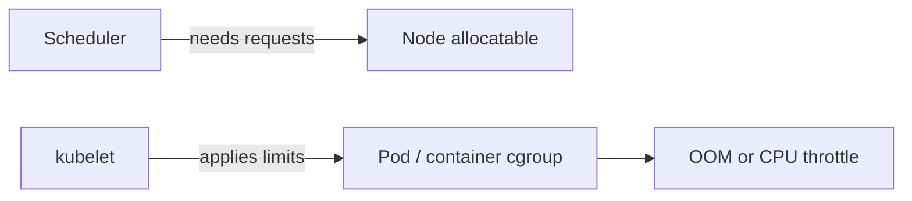

# 03 — cgroups: budgets, not walls

## ELI5 hook

Namespaces are frosted-glass walls (what you *see*). **cgroups** (control groups) are the **allowance chart on the fridge**: how much CPU, memory, and I/O your room may spend. You can still *see* the whole fridge; you just can’t eat everyone’s yogurt.

## Mental model

| Concept | Role |
|---------|------|
| **cgroup** | A set of processes + resource controllers (cpu, memory, io, …) |
| **Limit** | Hard ceiling — exceed memory → OOM kill |
| **Request / weight** | Soft claim — used for fair sharing and (in K8s) scheduling |
| **OOM killer** | Kernel picks a victim when memory is exhausted |

cgroups do **not** hide other processes’ memory from you by themselves. They **account and constrain**.

Modern Linux uses **cgroup v2** (unified hierarchy). You may still see v1 on older nodes — same ideas, different file layout.

## What Linux does

### Find your cgroup

```bash
cat /proc/self/cgroup
# cgroup v2 often looks like: 0::/user.slice/user-1000.slice/...
```

### Controllers live in a filesystem

```bash
mount | grep cgroup
ls /sys/fs/cgroup
```

Typical v2 knobs (paths vary by distro):

```bash
# Memory max (example — don't run wild on a shared machine)
cat /sys/fs/cgroup/memory.max          # for the root; prefer a child cgroup
cat /sys/fs/cgroup/cpu.max
```

### CPU: quota vs weight

- **cpu.max** — hard quota (`max` period = unlimited)
- **cpu.weight** — relative share when CPUs are contended

A process with a tiny weight still *can* use a whole core if nobody else wants it — until contention hits.

### Memory and OOM

When a cgroup hits `memory.max`, the kernel reclaims, then **OOM-kills** inside that cgroup. From inside a container this looks like “my process vanished with 137” (128 + SIGKILL).

```bash
dmesg -T | grep -i oom | tail
```

## How Kubernetes uses it

Kubernetes Resource model maps onto cgroups:

| Pod field | Typical meaning |
|-----------|-----------------|
| `resources.requests.cpu` | Scheduling + (often) cpu weight / shares |
| `resources.limits.cpu` | cpu quota (throttling when exceeded) |
| `resources.requests.memory` | Scheduling + often soft accounting |
| `resources.limits.memory` | `memory.max` — hit it → OOMKill |



**Burstable / Guaranteed / BestEffort** Quality of Service classes are derived from how you set requests vs limits — they influence **kubelet eviction** order under node pressure, not magic fairness fairy dust.

### Eviction vs OOM

- **cgroup OOM** — this container/pod blew its own memory limit
- **Node eviction** — kubelet kills pods to protect the node (disk/memory pressure), guided by QoS and user priority

Different mechanisms; both end with a dead pod.

## Lab

```bash
sudo ./courses/k8s-internals/labs/03-cgroups-demo.sh
```

Or a safe observational lab:

```bash
# See the hierarchy
ls /sys/fs/cgroup
cat /proc/self/cgroup

# If Docker/podman available: run with a memory limit and inspect
docker run --rm -m 64m alpine cat /sys/fs/cgroup/memory.max 2>/dev/null \
  || docker run --rm -m 64m alpine cat /sys/fs/cgroup/memory/memory.limit_in_bytes
```

Stress lab (only on a machine you own):

```bash
# Allocate until the limit trips (expects OOM)
docker run --rm -m 32m progrium/stress --vm 1 --vm-bytes 64M --timeout 10s || true
```

## Gotchas

- **Requests without limits** — Schedulable and able to burst; can starve neighbors or trigger node pressure.
- **CPU limit throttling** — Latency spikes that look like “GC pauses” or “network slowness” but are CFS throttling.
- **limit < request** — Invalid / rejected; limits must be ≥ requests when both set.
- **Pid limits** — `pids.max` stops fork bombs; K8s can set `PodPidsLimit` at the kubelet.
- **cgroup v1 vs v2** — Drivers and monitoring differ; prefer nodes on v2 for new clusters.

## Checkpoint

cgroups answer: *How much of the machine may this process tree consume?*

Next: [04 — Security primitives](04-security-primitives.md).

---

**Quiz arc:** after chapters 01–04 → [`/quizzes/k8s-linux-foundations/`](/quizzes/k8s-linux-foundations/)
