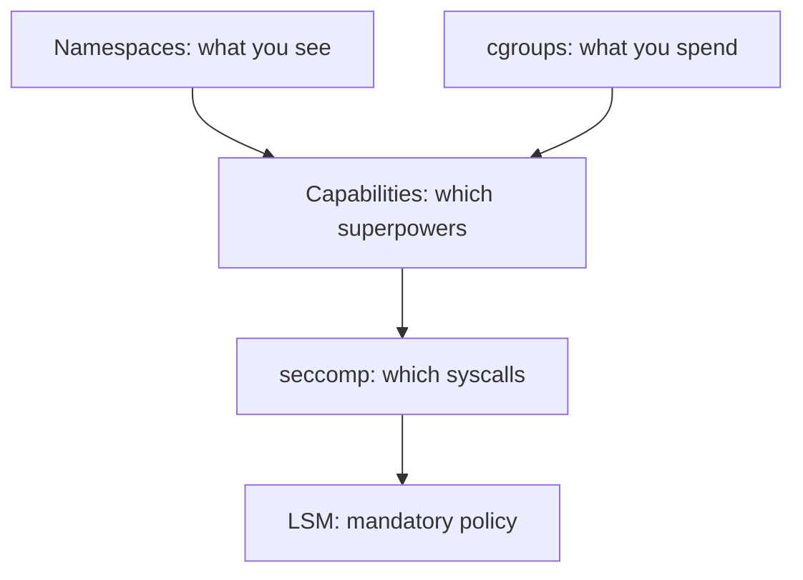

# 04 — Security primitives: least privilege at the kernel

## ELI5 hook

Even inside a frosted-glass room with a snack budget, you shouldn’t get the master keys to the whole building. Linux splits “root powers” into **capabilities**, filters scary system calls with **seccomp**, and can stamp processes with mandatory labels (**AppArmor / SELinux**). Kubernetes turns these knobs per Pod.

## Mental model

Defense in depth for a container:



| Layer | Question it answers |
|-------|---------------------|
| User / UID | Who are you numerically? |
| Capabilities | Which privileged ops remain? |
| seccomp | Which syscalls are allowed? |
| LSM | Does policy allow this label/path/socket? |
| Read-only rootfs / drops | Can you rewrite your own image? |

## What Linux does

### Capabilities

Historically: UID 0 could do everything. Now many privileges are bits: `CAP_NET_ADMIN`, `CAP_SYS_ADMIN`, `CAP_NET_RAW`, …

```bash
# Capabilities of current shell (often none special)
grep Cap /proc/self/status
# Decode with:
capsh --decode=$(grep CapEff /proc/self/status | awk '{print $2}')
```

Dropping capabilities is how “root in a container” becomes *less* catastrophic — still not harmless.

### seccomp

A **syscall filter**. Profiles blacklist or allowlist calls like `reboot`, `mount`, `ptrace`. Docker/containerd apply a default profile; Kubernetes can set `seccompProfile`.

### LSM (AppArmor / SELinux)

Mandatory Access Control: even root-with-capabilities can be denied. Nodes usually run one major LSM style. Pods can request profiles (`appArmorProfile`, SELinux options).

### User namespaces

Map container UID 0 → unprivileged host UID. Strong isolation win; not every cluster enables it everywhere yet (growing support via Kubernetes user namespace features).

## How Kubernetes uses it

Pod Security surfaces (modern clusters: **Pod Security Admission** / PSS levels: Privileged, Baseline, Restricted):

| Knob | Spec field (examples) |
|------|------------------------|
| Run as non-root | `securityContext.runAsNonRoot` |
| Drop caps | `securityContext.capabilities.drop: ["ALL"]` |
| Add caps | `capabilities.add` (avoid unless needed) |
| seccomp | `seccompProfile.type: RuntimeDefault` |
| Privileged | `privileged: true` — nearly host-equivalent; treat as root on node |
| Hostpath / hostNetwork / hostPID | Escape hatches that weaken isolation |

```yaml
securityContext:
  runAsNonRoot: true
  runAsUser: 1000
  readOnlyRootFilesystem: true
  allowPrivilegeEscalation: false
  capabilities:
    drop: ["ALL"]
  seccompProfile:
    type: RuntimeDefault
```

Admission controllers and policies (OPA/Gatekeeper, Kyverno, PSS) exist because **defaults are for convenience, not for your threat model**.

## Lab — inspect what you actually have

```bash
# Inside any container you can start:
docker run --rm alpine sh -c 'id; grep CapEff /proc/self/status; ls /proc/1'

# Privileged vs not (feel the difference carefully on a disposable VM)
docker run --rm alpine grep CapEff /proc/self/status
docker run --rm --privileged alpine grep CapEff /proc/self/status
```

On a kind cluster (if available):

```bash
kubectl run cap-demo --image=alpine --restart=Never -- sleep 3600
kubectl exec cap-demo -- grep Cap /proc/1/status
kubectl delete pod cap-demo
```

## Gotchas

- **Privileged containers** — Close to “be the node.” Needed rarely (e.g. some CSI/node agents); never for apps by default.
- **CAP_SYS_ADMIN** — The junk drawer of power; almost as bad as privileged for escape potential.
- **Root + writable hostPath** — Classic breakout pattern.
- **“We dropped ALL capabilities”** — Great, but still combine with non-root, read-only rootfs, seccomp, and no host namespaces.
- **PSS Restricted** — May break naive images that expect to write to `/` or bind low ports.

## Checkpoint

You now have the Linux trifecta: **see** (namespaces), **spend** (cgroups), **act** (capabilities/seccomp/LSM).

Next: [05 — OCI images](05-images-oci.md) — packing a root filesystem into a suitcase.

---

**Quiz:** [`/quizzes/k8s-linux-foundations/`](/quizzes/k8s-linux-foundations/) — take it before moving on.
