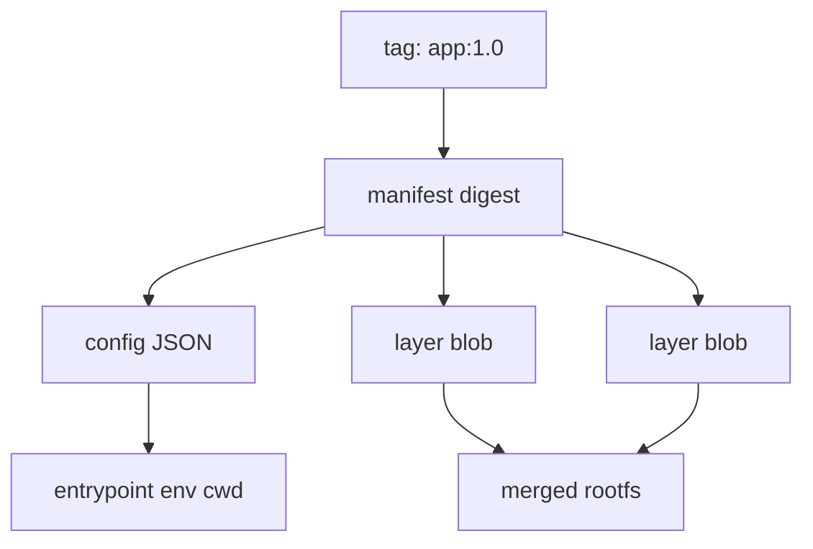

# 05 — OCI images: suitcases of files + config

## ELI5 hook

An image is a **suitcase**: neatly stacked layers of clothes (filesystem diffs) plus a luggage tag (config: which binary to run, env vars, working directory). A **container** is opening that suitcase into a room (namespaces + cgroup) and starting to live there.

## Mental model

| Term | Meaning |
|------|---------|
| **OCI Image** | Content-addressed bundle: layers + config + manifest |
| **Layer** | Tar diff (usually) — add/change/delete files |
| **Digest** | Hash (`sha256:…`) — immutable identity |
| **Tag** | Mutable nickname (`:latest`, `:1.2.3`) pointing at a digest |
| **Rootfs** | Merged view of layers mounted as the container’s `/` |

**Tags move. Digests don’t.** Production pins digests (or immutable tags you control).

## What Linux / OCI does

### Manifest → config → layers



### Overlay mounts

Runtimes typically use **overlayfs**: lower layers read-only, thin upper layer writable (the container’s changes). Delete the container → upper layer gone (unless you volume-mount data elsewhere).

```bash
# Explore locally with Docker/podman (implementation detail varies)
docker pull alpine:3.20
docker image inspect alpine:3.20 --format '{{.Id}} {{.RootFS.Layers}}'
```

### Building is just stacking diffs

Each Dockerfile `RUN` / `COPY` usually creates a layer. Fewer, purposeful layers → smaller pulls and clearer caching — but correctness > micro-optimizing layer count.

## How Kubernetes uses it

1. You set `image: registry.example/app@sha256:…` (or a tag)
2. **kubelet** asks the **CRI runtime** (containerd) to pull if missing
3. Runtime stores content in its content store, mounts rootfs, starts process

| Concern | Practice |
|---------|----------|
| Supply chain | Sign images (cosign), verify in admission |
| Drift | Pin digest; avoid `:latest` in prod |
| Pull secrets | `imagePullSecrets` for private registries |
| imagePullPolicy | `IfNotPresent` / `Always` / `Never` |

**ImagePullBackOff** means: registry auth, typo, network, or rate limit — not “Kubernetes is broken.”

## Lab — see layers and config

```bash
# Pull and show history (layer commands)
docker pull alpine:3.20
docker history alpine:3.20

# Config bits that become container process settings
docker image inspect alpine:3.20 --format 'Entrypoint={{.Config.Entrypoint}} Cmd={{.Config.Cmd}} User={{.Config.User}}'

# Digest vs tag
docker image inspect alpine:3.20 --format '{{index .RepoDigests 0}}'
```

Optional — export and peek (large; skip if low disk):

```bash
docker create --name tmp-alp alpine:3.20
docker export tmp-alp | tar -t | head
docker rm tmp-alp
```

## Gotchas

- **`:latest` lies** — Yesterday’s latest ≠ today’s; nodes may have different cached images with `IfNotPresent`.
- **Fat images** — Debug tools in prod images expand attack surface; prefer distroless/minimal + separate debug profiles.
- **Writable rootfs by default** — Combine with `readOnlyRootFilesystem` and emptyDir for `/tmp`.
- **Multi-arch** — Manifest lists pick amd64/arm64; wrong arch → weird exec format errors.

## Checkpoint

Images package a **filesystem + process recipe**. Runtimes turn that into **namespaces + cgroup + exec**.

Next: [06 — containerd & CRI](06-containerd-cri.md).

---

**Quiz arc:** after chapters 05–07 → [`/quizzes/k8s-containers-runtime/`](/quizzes/k8s-containers-runtime/)
