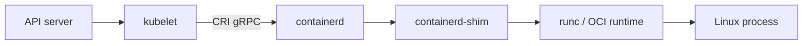

# 06 — containerd & CRI: who actually starts containers

## ELI5 hook

Kubernetes is the **manager with a clipboard**. It does not personally unpack suitcases. It calls a **runtime** through a standard intercom called **CRI** (Container Runtime Interface). On most clusters that runtime is **containerd**, which asks **runc** (or another OCI runtime) to create the namespaces and `exec` your process.

## Mental model



| Piece | Job |
|-------|-----|
| **kubelet** | Wants Pod sandbox + containers to match API |
| **CRI** | API: run pod sandbox, create container, exec, stats |
| **containerd** | Image pull, content store, snapshotters, task management |
| **shim** | Per-container babysitter so containerd can restart |
| **runc** | Low-level OCI: namespaces, cgroups, pivot_root, exec |

**Docker** as an engine is optional. Kubernetes talks CRI; containerd speaks CRI natively. (Historical: dockershim was removed.)

## What the runtime does

Rough lifecycle for one container:

1. Ensure image present (pull by reference)
2. Prepare snapshot / rootfs mount
3. Create OCI bundle (`config.json` + rootfs)
4. `runc create` / `runc start` → process in namespaces
5. Stream logs, attach exec, collect exit code

### crictl — talk CRI like kubelet does

On nodes (and kind nodes):

```bash
sudo crictl version
sudo crictl images
sudo crictl pods
sudo crictl ps -a
```

`crictl` is the flashlight when `kubectl` says `ContainerCreating` forever.

## How Kubernetes uses it

| Kubernetes object | CRI-ish concept |
|-------------------|-----------------|
| Pod | **Pod sandbox** (pause + shared namespaces) + containers |
| `kubectl exec` | CRI `Exec` / attach |
| `kubectl logs` | Runtime log files / log drivers |
| RuntimeClass | Select alternate handlers (e.g. gVisor, Kata) |
| Ephemeral containers | Extra containers into an existing sandbox |

**RuntimeClass** lets you say: this Pod should run under a different OCI runtime handler — still CRI, different isolation tech.

## Lab

If you have kind:

```bash
kind create cluster --name cri-lab   # skip if you already have a cluster
docker exec -it cri-lab-control-plane bash
# inside node:
crictl images | head
crictl pods
crictl ps
```

Or use the helper script from the host (expects kind):

```bash
./courses/k8s-internals/labs/08-crictl-inspect.sh
```

Without kind — watch Docker’s runtime cousin:

```bash
docker run -d --name crio-demo alpine sleep 300
docker inspect crio-demo --format '{{.HostConfig.Runtime}} pid={{.State.Pid}}'
ps -p $(docker inspect -f '{{.State.Pid}}' crio-demo) -o pid,cmd
docker rm -f crio-demo
```

## Gotchas

- **Debugging on the wrong layer** — `kubectl describe` for API; `crictl` / journald for runtime; `dmesg` for OOM.
- **Image exists in Docker but not containerd** — Different stores. On kind, use `kind load docker-image`.
- **Pleg / CRI timeouts** — kubelet can’t list pods → node NotReady; check containerd health.
- **shim leaks** — Rare, but stuck shims hold resources; node reboot or careful cleanup.

## Checkpoint

kubelet **declares**; CRI runtime **creates Linux reality**.

Next: [07 — Pods](07-pods.md) — why the sandbox exists.

---

**Quiz arc:** after chapters 05–07 → [`/quizzes/k8s-containers-runtime/`](/quizzes/k8s-containers-runtime/)
