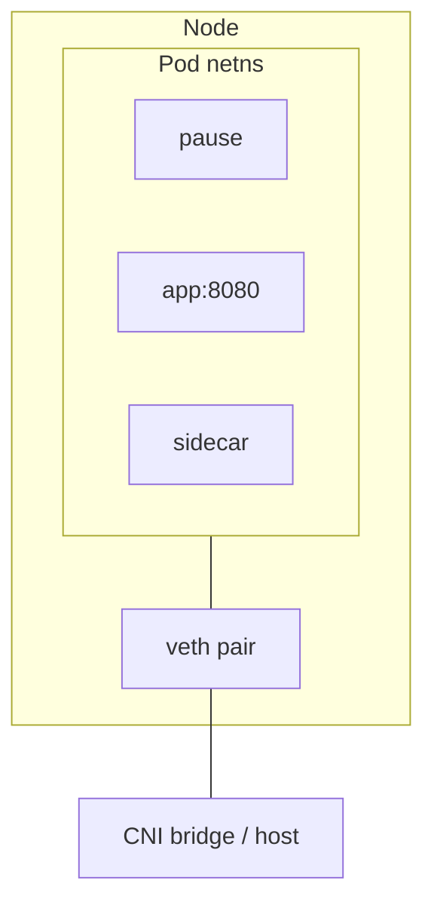

# 07 — Pods: shared fate, shared network namespace

## ELI5 hook

A Pod is a **shared apartment**. Roommates (containers) share the front door address (Pod IP / netns), the hallway whiteboard (IPC), and the apartment nameplate (UTS hostname). Each still has a private bedroom closet (mount namespace / rootfs). When the lease ends, everyone moves out together.

## Mental model

A Pod is the **atomic scheduling unit** in Kubernetes: one IP, one placement on one node, one shared fate.

| Shared (typical) | Private (typical) |
|------------------|-------------------|
| network namespace | mount namespace / rootfs |
| IPC namespace | PID namespace (unless opted in) |
| UTS (hostname) | process list |
| volumes you attach | image layers |

The **pause** container holds the shared namespaces so the apartment exists even while app containers restart.

## What Linux does



- Containers in a Pod talk over **`127.0.0.1`** — same netns
- Cross-pod talk uses **Pod IPs** or **Services** (chapter 12)
- `shareProcessNamespace: true` → shared PID ns (sidecars can signal/see each other)

## How Kubernetes uses it

### Why not one-container-only forever?

Pods enable **multi-container patterns**:

| Pattern | Role |
|---------|------|
| Sidecar | Helper (proxy, log shipper) beside app |
| Adapter | Normalize output |
| Ambassador | Outbound proxy |
| Init containers | Run to completion before app starts |
| Ephemeral containers | Live debugger attached to a running Pod |

### Lifecycle highlights

- **Init containers** — sequential; fail → Pod fails
- **RestartPolicy** — Always / OnFailure / Never (Pods themselves don’t “reschedule” when deleted; controllers create replacements)
- **Probes** — kubelet HTTP/TCP/exec checks (chapter 08)
- **Termination** — SIGTERM, then SIGKILL after `terminationGracePeriodSeconds`

### Pod YAML → Linux (mental map)

```yaml
spec:
  containers:
    - name: app
      image: my/app:1.2
      ports:
        - containerPort: 8080   # documentation + Service targeting; not a publish
      volumeMounts:
        - mountPath: /data
          name: data
  volumes:
    - name: data
      emptyDir: {}             # node-local dir mounted into mnt ns
```

`containerPort` does **not** open a host port by itself. It’s metadata. Host publishing is `hostPort` / NodePort / LB / Ingress.

## Lab

```bash
./courses/k8s-internals/labs/07-pod-netns.sh
```

Manual kind lab — prove localhost between containers:

```bash
kubectl apply -f - <<'EOF'
apiVersion: v1
kind: Pod
metadata:
  name: roommates
spec:
  containers:
    - name: server
      image: busybox:1.36
      command: ["nc", "-lk", "-p", "8080", "-e", "echo", "hi-from-server"]
      # note: busybox nc variants differ; alternative below if this fails
    - name: client
      image: busybox:1.36
      command: ["sh", "-c", "sleep 3600"]
EOF

# Simpler reliable demo:
kubectl delete pod roommates --ignore-not-found
kubectl apply -f - <<'EOF'
apiVersion: v1
kind: Pod
metadata:
  name: roommates
spec:
  containers:
    - name: server
      image: nginx:1.25-alpine
      ports:
        - containerPort: 80
    - name: client
      image: busybox:1.36
      command: ["sh", "-c", "sleep 3600"]
EOF

kubectl wait --for=condition=Ready pod/roommates --timeout=60s
kubectl exec roommates -c client -- wget -qO- http://127.0.0.1/
kubectl delete pod roommates
```

## Gotchas

- **Two containers, two ports, one IP** — They cannot both bind the same port in the shared netns.
- **Sidecar dies** — Depending on restart policy and probes, the Pod may flap; design readiness carefully.
- **Init + Secrets** — Init can populate volumes before app starts; common for permission fixes.
- **Don’t put multiple unrelated apps in one Pod** — Coupling deployment, scaling, and failure domains.

## Checkpoint

Pods are **co-scheduled containers sharing network (and more)**. The pause sandbox is the apartment lease.

Next: [08 — kubelet](08-kubelet.md).

---

**Quiz:** [`/quizzes/k8s-containers-runtime/`](/quizzes/k8s-containers-runtime/)
