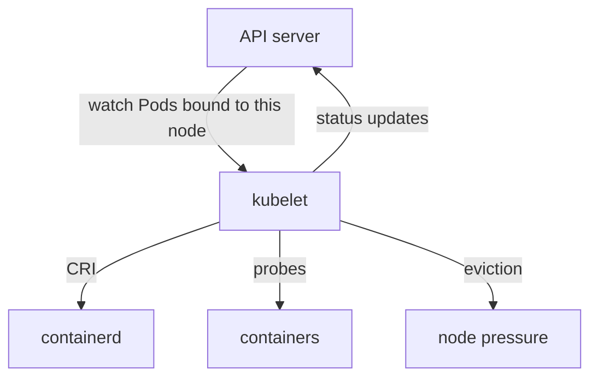

# 08 — kubelet: the node babysitter

## ELI5 hook

The **kubelet** is the babysitter on each machine. The control plane posts a chore chart (“these Pods should run here”). The kubelet checks the crib (CRI runtime) all day: start what’s missing, restart what crashed, report who’s hungry (metrics), and kick out kids if the house is out of milk (eviction).

## Mental model

kubelet is the **agent that makes local reality match assigned Pod specs**.



| Loop | Purpose |
|------|---------|
| Sync | Desired Pods vs running sandboxes/containers |
| PLEG | Pod Lifecycle Event Generator — notice started/stopped |
| Probes | liveness / readiness / startup |
| Status | Report phase, conditions, pod IP, restarts |
| Eviction | Free node resources under pressure |

## What Linux + kubelet do

### Probes (health checks)

| Probe | Failure meaning |
|-------|-----------------|
| **startup** | Give slow apps time before liveness starts |
| **liveness** | Restart container (process unhealthy) |
| **readiness** | Remove from Service endpoints (not ready for traffic) |

Probes are executed by kubelet (HTTP GET, TCP socket, or exec in the container). Mis-tuned liveness = **flapping restarts**. Mis-tuned readiness = **silent traffic blackhole**.

### Volume mounts

kubelet attaches/mounts volumes (CSI, emptyDir, configMap, secret) into the container mount namespace before start. Secrets often become tmpfs files.

### cgroups

kubelet (with the runtime) places containers into the Pod’s cgroup hierarchy using requests/limits (chapter 03).

## How Kubernetes uses it

Pod scheduled → `spec.nodeName` set → **that** kubelet owns it.

| Symptom | First suspect |
|---------|----------------|
| `ContainerCreating` stuck | Image pull, volume mount, CNI, CRI |
| `CrashLoopBackOff` | Process exits; check logs + `describe` |
| `Ready=False` | Readiness probe / dependencies |
| Node `NotReady` | kubelet down, runtime down, disk pressure, network to API |

Static pods (manifests in `/etc/kubernetes/manifests`) are also kubelet-driven — how control-plane self-hosts on many clusters.

## Lab

```bash
# Watch kubelet-ish signals via API
kubectl run probe-demo --image=nginx:1.25-alpine
kubectl describe pod probe-demo | sed -n '/Conditions/,/Volumes/p'
kubectl get pod probe-demo -o wide
kubectl delete pod probe-demo

# On a kind node — runtime view
./courses/k8s-internals/labs/08-crictl-inspect.sh
```

## Gotchas

- **Liveness hitting a busy dependency** — Restarts make overload worse; use readiness for deps, liveness for deadlocks.
- **Exec probes** — Fork cost under load; prefer HTTP where possible.
- **Image GC / eviction** — Disk pressure kills Pods and GC’s images; monitor node conditions.
- **Clock skew** — Certificates and lease renewals get weird; keep NTP healthy.

## Checkpoint

kubelet = **node-local reconciler** + probe runner + eviction officer.

Next: [09 — API server & etcd](09-api-etcd.md).

---

**Quiz arc:** after chapters 08–11 → [`/quizzes/k8s-node-control-plane/`](/quizzes/k8s-node-control-plane/)
