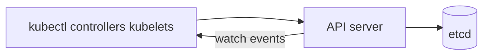

# 09 — API server & etcd: the desired-state store

## ELI5 hook

etcd is the **single notebook** everyone trusts. The **API server** is the only librarian allowed to write in it. You never scribble on the notebook yourself — you ask the librarian (`kubectl`, controllers, kubelets), who checks your library card (authn/authz), validates handwriting (admission/schema), then writes the page and tells watchers “page 42 changed.”

## Mental model



| Component | Role |
|-----------|------|
| **API server** | HTTP/JSON (or Protobuf) front door; authn, authz, admission, validation |
| **etcd** | Consistent key-value store; Kubernetes objects as serialized data |
| **Watch** | Efficient “tell me when this changes” via resourceVersion |

**Desired state** lives in etcd. Controllers and kubelets **converge actual state** toward it.

## What etcd / API do

### Objects are keys

Rough mental path (simplified):

```text
/registry/pods/default/my-pod
/registry/deployments/default/my-deploy
```

Each write bumps a **resourceVersion**. Watches resume from a version so clients don’t miss events (within history window).

### Request path (simplified)

1. TLS + authentication (cert, token, OIDC, …)
2. Impersonation (optional)
3. Authorization (RBAC)
4. Mutual TLS / admission chain (mutating → validating)
5. Validation + storage write to etcd
6. Notify watchers

### Consistency

etcd uses Raft. A majority of etcd members must agree. **Lose quorum → cluster read-only or unavailable** — protect etcd like the crown jewels.

## How Kubernetes uses it

| Actor | Reads / writes |
|-------|----------------|
| You (`kubectl apply`) | Write desired objects |
| Controllers | Watch → write child objects / status |
| kube-scheduler | Bind Pods (`spec.nodeName`) |
| kubelet | Watch Pods for its node; patch status |
| kube-proxy / CNI helpers | Watch Services/Endpoints |

Status subresources (`kubectl patch --subresource=status`) keep **status** updates from fighting **spec** updates.

## Lab

```bash
# Feel the API, not etcd directly
kubectl get --raw /api/v1 | head
kubectl api-resources | head
kubectl get pods -o json | jq '.metadata.resourceVersion'

# Watch stream (Ctrl+C to stop)
kubectl get pods --watch-only &
sleep 1
kubectl run watch-demo --image=busybox --restart=Never --command -- sleep 10
wait
kubectl delete pod watch-demo --ignore-not-found
```

On self-hosted control planes you might see etcd pods/static pods — treat credentials and snapshots as backup-critical.

## Gotchas

- **etcd disk latency** — Slow disks → slow API → cascading timeouts.
- **Giant objects / too many watches** — API server memory and etcd size hurt; CRDs with huge status are common offenders.
- **“kubectl get works, apply fails”** — Authz, admission webhook down, or validation — read the error body.
- **Never point random tools at etcd** — Always go through the API unless you are a recoveryman with a runbook.

## Checkpoint

API server + etcd = **source of truth**. Everything else is a reconciler or a cache.

Next: [10 — Controllers](10-controllers.md).

---

**Quiz arc:** after chapters 08–11 → [`/quizzes/k8s-node-control-plane/`](/quizzes/k8s-node-control-plane/)
