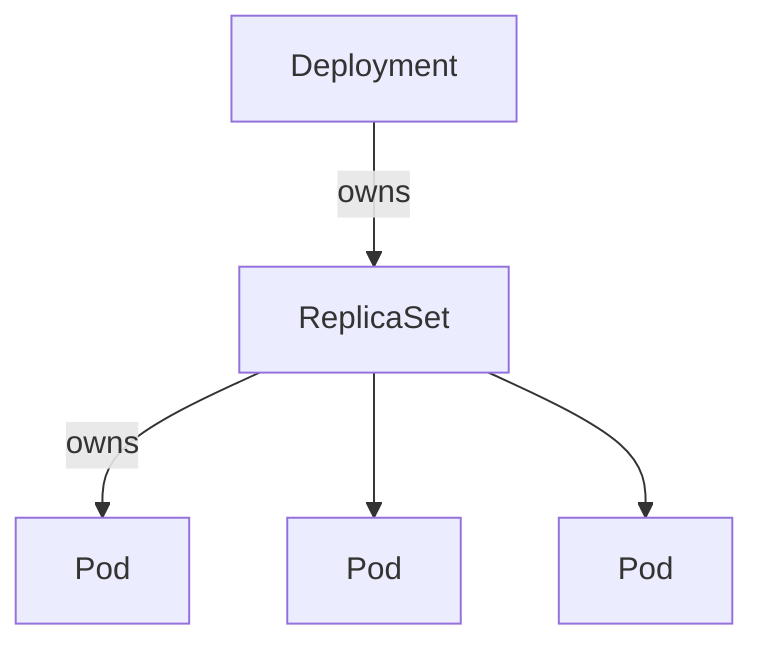

# 10 — Controllers: reconcile forever

## ELI5 hook

A controller is a **persistent toddler with a checklist**: “There should be 3 toys on the shelf.” It looks. If there are 2, it adds one. If there are 4, it puts one away. It never “finishes” — the world drifts, so it **reconciles forever**.

## Mental model

```text
for {
  desired := read_from_api()
  actual  := observe_world()          // usually also via API objects
  actions := diff(desired, actual)
  apply(actions)
}
```

In Kubernetes, “observe the world” usually means **other API objects** (Pods, ReplicaSets), not SSH into nodes. kubelet bridges API ↔ Linux.

### Informers & workqueues

Controllers rarely hammer `LIST` in a tight loop. They use **shared informers**: LIST once, WATCH forever, keep a local cache, enqueue keys on change, workers process the queue with retries/rate limits.

## What the classic Deployment stack does



| Controller | Ensures |
|------------|---------|
| **Deployment** | ReplicaSets for versions; rolling updates |
| **ReplicaSet** | N Pods matching a template/label selector |
| **Job** | N successful completions |
| **DaemonSet** | One Pod per eligible node |
| **StatefulSet** | Identity + stable storage per ordinal |
| **Node / cloud controllers** | Node lifecycle, routes, etc. |

Owner references + garbage collection: delete a Deployment → cascade deletes RS → Pods (depending on policy).

## How Kubernetes uses it

**Level-triggered, not edge-triggered:** missing an event is OK; the next reconcile re-reads desired vs actual. That’s why Kubernetes survives blips.

Controllers write:

- New objects (Pods)
- Spec fields (rarely — prefer ownership of children)
- Status (observed generation, conditions, replicas)

Custom operators are **your** controllers for CRDs — same pattern, your domain logic.

## Lab

```bash
kubectl create deployment hello --image=nginx:1.25-alpine --replicas=2
kubectl get deploy,rs,pods -l app=hello
kubectl scale deploy hello --replicas=3
kubectl get rs,pods -l app=hello

# Rolling update
kubectl set image deploy/hello nginx=nginx:1.26-alpine
kubectl rollout status deploy/hello
kubectl get rs

kubectl delete deploy hello
```

Watch the API chatter:

```bash
kubectl get pods --watch &
kubectl scale deploy hello --replicas=1   # if still present
```

## Gotchas

- **Fighting controllers** — Two owners mutating the same field = flap. One owner per concern.
- **Label selector mismatches** — ReplicaSet “adopts” or ignores Pods based on labels; orphan Pods confuse humans.
- **CrashLoop + progress deadline** — Deployment may mark progress timed out; read `describe deploy`.
- **Finalizers** — Objects stuck in Terminating until a controller clears its finalizer — or you understand why it’s blocked.

## Checkpoint

Controllers = **continuous reconciliation** against the API. Deployments don’t “run containers”; they ensure ReplicaSets that ensure Pods that kubelets run.

Next: [11 — Scheduler](11-scheduler.md).

---

**Quiz arc:** after chapters 08–11 → [`/quizzes/k8s-node-control-plane/`](/quizzes/k8s-node-control-plane/)
