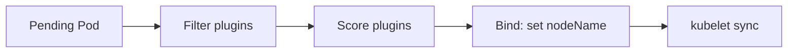

# 11 — Scheduler: who goes where

## ELI5 hook

The scheduler is a **seat assigner at a theater**. Pods without seats (`nodeName` empty) wait in line. The scheduler checks which seats fit (filters), scores the comfy ones (prioritize), then **writes your ticket** (`nodeName`). It does **not** start the show — kubelet does once the ticket exists.

## Mental model



| Phase | Examples |
|-------|----------|
| **Filter** | Enough CPU/memory? Node selector? Taints? Affinity? Ports? PVC zone? |
| **Score** | Spread, least requested, affinity preference |
| **Bind** | Atomic API update assigning the node |

If no node passes filters → Pod stays **Pending** with events explaining why.

## What the scheduler considers

### Resources

Uses **requests** (not limits) for packing math against node **allocatable**.

### Taints & tolerations

Node: “no un-tolerated Pods.” Pod: “I tolerate this taint.” Control-plane nodes usually taint themselves.

### Affinity / topology

- **nodeAffinity** — prefer/require certain node labels
- **podAffinity / antiAffinity** — sit with / away from other Pods
- **topologySpreadConstraints** — even spread across zones/hosts

### Preemption

Higher PriorityClass Pods can evict lower ones to make room — still subject to PDBs and graceful termination.

## How Kubernetes uses it

| Object | Effect |
|--------|--------|
| `nodeSelector` / affinity | Hard/soft placement rules |
| `tolerations` | Allow tainted nodes |
| `PriorityClass` | Scheduling order + preemption power |
| `RuntimeClass` | May constrain eligible nodes |
| PVC + storage topology | Schedule where volume can attach |

Multiple schedulers can coexist (`schedulerName`); default is `default-scheduler`.

## Lab

```bash
# Pending due to impossible request (adjust if your node is huge)
kubectl apply -f - <<'EOF'
apiVersion: v1
kind: Pod
metadata:
  name: too-fat
spec:
  containers:
    - name: pause
      image: registry.k8s.io/pause:3.9
      resources:
        requests:
          memory: "16Ti"
EOF

kubectl describe pod too-fat | tail -20
kubectl delete pod too-fat

# Taint experiment (kind single-node — untaint when done!)
NODE=$(kubectl get nodes -o jsonpath='{.items[0].metadata.name}')
kubectl taint node "$NODE" course=demo:NoSchedule
kubectl run stuck --image=registry.k8s.io/pause:3.9
kubectl describe pod stuck | grep -A5 Events || true
kubectl delete pod stuck
kubectl taint node "$NODE" course=demo:NoSchedule-
```

## Gotchas

- **Limits don’t reserve** — A node can overcommit limits; requests drive scheduling.
- **Local PV / hostPath** — Pins you; scheduling must match.
- **Pending forever** — Read Events; don’t restart the Pod as a first fix.
- **Custom schedulers** — Batch/ML systems often bring their own; Pods must set `schedulerName`.

## Checkpoint

Scheduler **assigns**; kubelet **runs**. Pending means “no legal seat,” not “Linux failed.”

Next: [12 — Networking](12-networking.md).

---

**Quiz:** [`/quizzes/k8s-node-control-plane/`](/quizzes/k8s-node-control-plane/)
