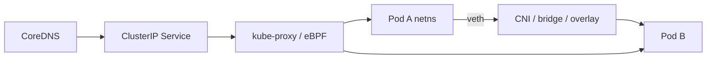

# 12 — Networking: Pod IP → Service → world

## ELI5 hook

Every Pod gets a **phone number** (IP) on a private switch. A **Service** is a **stable directory listing** (“call the checkout team”) that forwards to whoever is on shift (ready Pods). **kube-proxy** (or eBPF dataplane) programs the building’s call router. **CNI** plugs each apartment’s phone into the switch.

## Mental model



### Kubernetes networking model (promises)

1. Every Pod gets its own IP
2. Pods can reach other Pods without NAT (on most setups)
3. Agents on a node can reach all Pods

How those promises are implemented is **CNI plugin territory** (kindnet, Calico, Cilium, Flannel, …).

## What Linux does

| Piece | Linux reality |
|-------|---------------|
| Pod netns | Isolated network stack + interfaces |
| veth pair | Virtual ethernet cable: pod ↔ host |
| Bridge / VXLAN / BGP / eBPF | How packets cross nodes |
| iptables / nftables / IPVS | Service VIP load-balancing (classic kube-proxy) |
| conntrack | Tracks flows for NAT |

### Services

| Type | Behavior |
|------|----------|
| **ClusterIP** | VIP inside cluster |
| **NodePort** | Opens high port on nodes → Service |
| **LoadBalancer** | Cloud/metal LB → NodePort/ClusterIP |
| **ExternalName** | DNS CNAME alias |
| **headless** | `ClusterIP: None` — DNS returns Pod IPs |

**Endpoints / EndpointSlices** list ready backend IPs:ports. No ready Pods → VIP blackholes traffic.

### DNS

CoreDNS: `my-svc.my-namespace.svc.cluster.local`. Pods resolve Services by name — that’s why apps use DNS, not Pod IPs.

## How Kubernetes uses it

```yaml
apiVersion: v1
kind: Service
metadata:
  name: shop
spec:
  selector:
    app: shop
  ports:
    - port: 80
      targetPort: 8080
```

Traffic path (classic):

1. Client dials `shop` → ClusterIP:80
2. kube-proxy DNAT to a backend PodIP:8080
3. Return path via conntrack

**NetworkPolicy** (chapter 15) filters who may talk — implemented by the CNI, not kube-proxy.

## Lab

```bash
kubectl create deploy shop --image=nginx:1.25-alpine
kubectl expose deploy shop --port=80 --target-port=80
kubectl run curl --image=busybox:1.36 --restart=Never -- sleep 3600
kubectl wait --for=condition=Ready pod/curl --timeout=60s
kubectl exec curl -- wget -qO- http://shop/
kubectl get endpoints shop
kubectl get endpointslice -l kubernetes.io/service-name=shop

kubectl delete pod curl deploy/shop svc/shop
```

Inspect dataplane hints on a node (kind):

```bash
docker exec kind-control-plane iptables-save 2>/dev/null | head -40 || true
```

## Gotchas

- **Not Ready → removed from Endpoints** — readiness probe bugs look like “Service is down.”
- **hairpin / SNAT** — Some paths rewrite source IPs; apps that trust client IP need care (EXTERNAL-IP, proxy protocol).
- **hostNetwork** — Shares node netns; port conflicts with node services.
- **Conntrack exhaustion** — High churn Services can fill nf_conntrack; symptoms are random timeouts.

## Checkpoint

CNI gives Pods wires. Services give **stable virtual IPs**. DNS gives names. kube-proxy/eBPF programs forwarding.

Next: [13 — Ingress & Gateway](13-ingress-gateway.md).

---

**Quiz arc:** after chapters 12–14 → [`/quizzes/k8s-networking-storage/`](/quizzes/k8s-networking-storage/)
