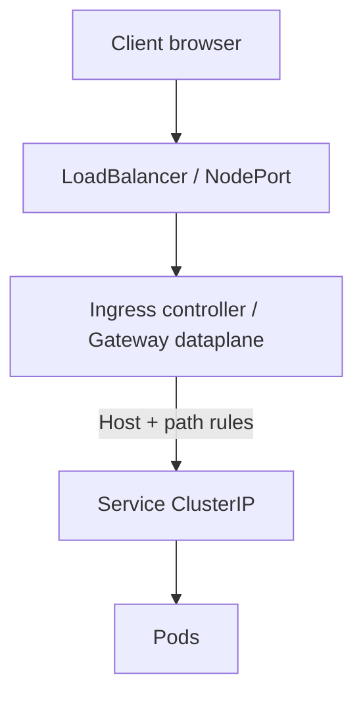

# 13 — Ingress & Gateway: the L7 front door

## ELI5 hook

Services are **internal phone extensions**. **Ingress** (and the newer **Gateway API**) are the **receptionist at the street entrance**: “If the host is `shop.example.com` and path starts with `/api`, send them to the shop Service.” They speak HTTP(S) — layer 7 — not just raw TCP ports.

## Mental model



| Object | Role |
|--------|------|
| **Ingress** | Declarative HTTP routing rules (older, widely used) |
| **Ingress controller** | Actual reverse proxy (nginx, Traefik, HAProxy, cloud L7) |
| **Gateway API** | Newer, role-oriented APIs (Gateway, HTTPRoute, …) |
| **Service** | Still the backend target |

**Without a controller, Ingress objects do nothing.** They are wishes; the controller is the genie.

## What Linux / the proxy does

The controller Pod (or node agent) programs a reverse proxy:

- TLS terminate (secrets as certs)
- Host/path routing
- Optional rewrites, timeouts, sticky sessions (implementation-specific annotations historically)

Data path still ends at **ClusterIP → Pod IP** using the same Service machinery from chapter 12.

## How Kubernetes uses it

### Ingress (classic shape)

```yaml
apiVersion: networking.k8s.io/v1
kind: Ingress
metadata:
  name: shop
spec:
  ingressClassName: nginx
  rules:
    - host: shop.local
      http:
        paths:
          - path: /
            pathType: Prefix
            backend:
              service:
                name: shop
                port:
                  number: 80
```

### Gateway API (mental upgrade)

Separates concerns:

- **Cluster operator** — GatewayClass / Gateway (listeners, TLS at the edge)
- **App developer** — HTTPRoute attaches to a Gateway and routes to Services

More portable than annotation soup — prefer Gateway API for new platforms when available.

## Lab

If you have an Ingress controller (skip if not installed):

```bash
kubectl create deploy web --image=nginx:1.25-alpine
kubectl expose deploy web --port=80

# Example only — class name must match your controller
kubectl apply -f - <<'EOF'
apiVersion: networking.k8s.io/v1
kind: Ingress
metadata:
  name: web
spec:
  ingressClassName: nginx
  rules:
    - http:
        paths:
          - path: /
            pathType: Prefix
            backend:
              service:
                name: web
                port:
                  number: 80
EOF

kubectl get ingress web
kubectl describe ingress web
```

Without a controller, still learn the object model:

```bash
kubectl explain ingress.spec.rules
kubectl api-resources | grep -i gateway || echo "Gateway API CRDs not installed"
```

## Gotchas

- **No controller / wrong IngressClass** — Address empty, no traffic.
- **Annotations are vendor-specific** — `nginx.ingress.kubernetes.io/…` won’t apply to other controllers.
- **TLS secret type** — Must be `kubernetes.io/tls` with `tls.crt` / `tls.key`.
- **PathType** — `Exact` vs `Prefix` vs `ImplementationSpecific` surprises.
- **Exposing admin UIs** — Ingress is public by nature of placement; combine with authn at the edge.

## Checkpoint

Ingress/Gateway = **L7 routing onto Services**. Controllers implement; API objects declare.

Next: [14 — Storage](14-storage.md).

---

**Quiz arc:** after chapters 12–14 → [`/quizzes/k8s-networking-storage/`](/quizzes/k8s-networking-storage/)
