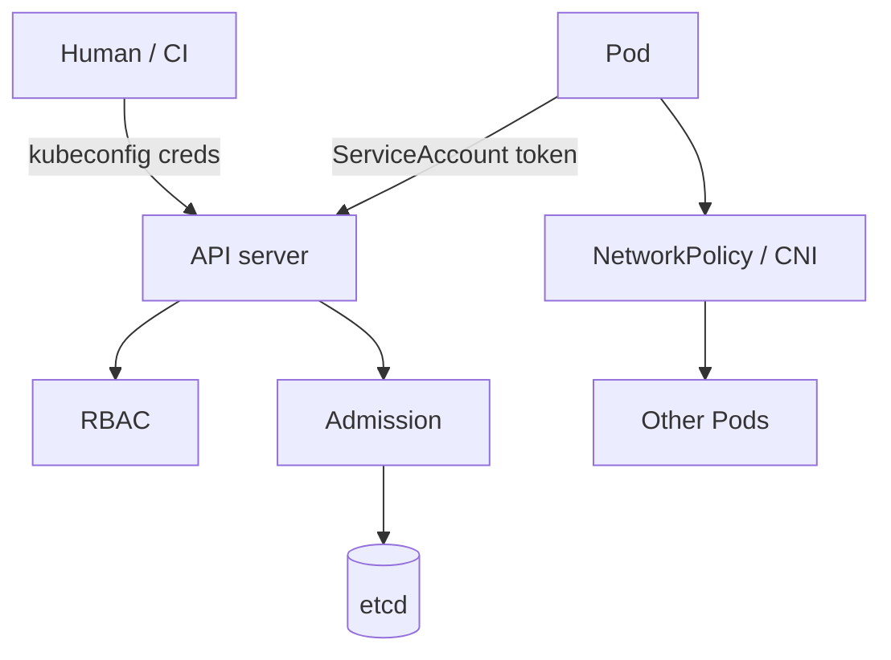

# 15 — Cluster security: trust on the API and the wire

## ELI5 hook

Chapter 04 gave processes seatbelts. Cluster security asks: **who may ask the librarian for which books**, and **which apartments may phone each other**. ServiceAccounts are name badges for Pods. **RBAC** is the permission matrix. **Admission** is the metal detector at the door. **NetworkPolicy** is who can dial whom.

## Mental model



| Layer | Controls |
|-------|----------|
| Authn | Who are you? (certs, OIDC, SA tokens, webhook) |
| Authz (RBAC) | What verbs on what resources? |
| Admission | Mutate/validate before persist |
| Pod security | Privileges inside the node (PSS) |
| NetworkPolicy | Pod ↔ Pod / egress allow rules |
| Secrets | Confidential data distribution (still encrypt etcd!) |

## What Kubernetes does

### ServiceAccounts

Every Pod gets an SA (default: `default`). The projected token mounts at `/var/run/secrets/kubernetes.io/serviceaccount/token` for in-cluster API calls. Prefer **per-app SAs** with minimal RBAC — never hand `cluster-admin` to a workload.

### RBAC

```text
Role / ClusterRole     = verbs + resources (+ optional resourceNames)
RoleBinding / ClusterRoleBinding = who gets that role (User, Group, SA)
```

Verbs: `get`, `list`, `watch`, `create`, `update`, `patch`, `delete`, …

### Admission

- **Mutating** — inject sidecars, defaults
- **Validating** — reject dangerous specs (PSS, policy engines)

If a validating webhook is **down**, you can brick creates/updates — monitor webhooks.

### NetworkPolicy

Default: all Pods can talk (unless your CNI defaults otherwise). Policies are **additive allow lists** for selected Pods — CNI enforces with iptables/eBPF.

## How to think in production

| Goal | Move |
|------|------|
| Least privilege API | Dedicated SA + Role + RoleBinding |
| Block privileged Pods | Pod Security Restricted / policy engine |
| Limit blast radius | Namespaces + NetworkPolicies |
| Secret hygiene | External KMS / sealed secrets / CSI secret store; encrypt etcd |
| Supply chain | Admission image verification |

## Lab

```bash
# Who can I do what as default SA? (usually very little)
kubectl auth can-i list pods --as=system:serviceaccount:default:default

# Create a locked-down SA + role
kubectl create sa course-reader
kubectl create role course-reader --verb=get,list --resource=pods
kubectl create rolebinding course-reader --role=course-reader --serviceaccount=default:course-reader
kubectl auth can-i list pods --as=system:serviceaccount:default:course-reader
kubectl auth can-i delete pods --as=system:serviceaccount:default:course-reader

kubectl delete rolebinding course-reader role course-reader sa course-reader
```

NetworkPolicy sketch (needs a CNI that enforces policies):

```bash
kubectl explain networkpolicy.spec
```

## Gotchas

- **default SA in every namespace** — Automount tokens; disable automount when unused.
- **ClusterRoleBinding sprawl** — Audit regularly; `kubectl get clusterrolebinding`.
- **RBAC allows `get secrets`** — Equivalent to reading passwords for that namespace.
- **NetworkPolicy without supporting CNI** — Objects apply; nothing enforces.
- **Webhook timeouts** — Fail-closed vs fail-open behavior matters for availability vs safety.

## Checkpoint

Secure clusters compose **API identity**, **RBAC**, **admission**, **pod isolation**, and **network policy** — on top of Linux primitives from chapters 01–04.

Next: [16 — Troubleshoot](16-troubleshoot.md).

---

**Quiz arc:** after chapters 15–16 → [`/quizzes/k8s-security-ops/`](/quizzes/k8s-security-ops/)
