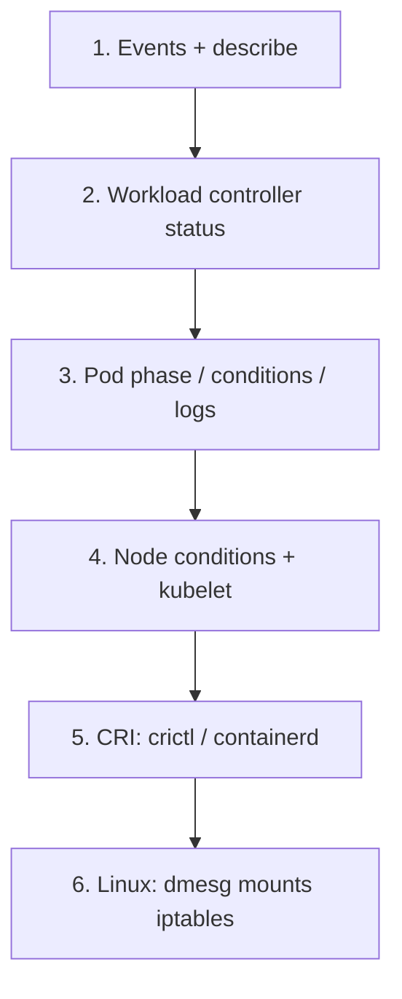

# 16 — Troubleshoot: debug like an owner

## ELI5 hook

When the toy breaks, don’t shake the whole house. Follow the **assembly line**: Wish (API) → Seat (scheduler) → Babysitter (kubelet) → Runtime (CRI) → Linux (process/net/disk). Each layer has a different flashlight.

## Mental model — the ladder



Ask: **Is desired state wrong, or is actual state failing to converge?**

## Playbooks

### Pending Pod

```bash
kubectl describe pod <name>   # Events at the bottom
kubectl get nodes -o wide
kubectl describe nodes | grep -A5 Allocatable
```

Common: insufficient CPU/memory, taints, PVC unbound, affinity, missing RuntimeClass.

### ImagePullBackOff

```bash
kubectl describe pod <name> | grep -A5 -i pull
# Check tag/digest, imagePullSecrets, registry auth, rate limits
```

### CrashLoopBackOff

```bash
kubectl logs <pod> -c <container> --previous
kubectl get pod <pod> -o jsonpath='{.status.containerStatuses[*].lastState}'
```

Process exited — fix the app/config, not “restart the node.”

### Service has no endpoints

```bash
kubectl get endpoints,endpointslice -l kubernetes.io/service-name=<svc>
kubectl get pods -l <selector> --show-labels
# readiness failing? label mismatch?
```

### Node NotReady

```bash
kubectl describe node <node>
# DiskPressure MemoryPressure NetworkUnavailable
# Then on the node: systemctl status kubelet containerd
```

### Network path

1. Pod → Pod IP directly
2. Pod → ClusterIP
3. DNS: `nslookup kubernetes` / `wget` to FQDN
4. NetworkPolicy deny?
5. CNI pods healthy?

### Volume stuck

```bash
kubectl describe pvc <pvc>
kubectl get volumeattachment
kubectl describe pod <pod>   # MountVolume timeouts
```

## Lab — deliberate failure drill

```bash
# 1) Bad image
kubectl run bad --image=ghcr.io/this-does-not-exist-12345/nope:latest
kubectl describe pod bad | tail -25
kubectl delete pod bad

# 2) Readiness that never passes
kubectl apply -f - <<'EOF'
apiVersion: v1
kind: Pod
metadata:
  name: never-ready
  labels:
    app: never
spec:
  containers:
    - name: nginx
      image: nginx:1.25-alpine
      readinessProbe:
        httpGet:
          path: /nope
          port: 80
        periodSeconds: 3
EOF
kubectl expose pod never-ready --port=80 --name=never-svc --selector=app=never
kubectl get endpoints never-svc
kubectl delete pod never-ready svc never-svc
```

Use [`labs/08-crictl-inspect.sh`](labs/08-crictl-inspect.sh) when API status lags runtime reality.

## Gotchas

- **Fixating on logs only** — Events explain scheduling/mount/pull; logs explain process.
- **Deleting Pending Pods** — Loses evidence; describe first, copy Events.
- **Wrong container in multi-container Pod** — Always `-c`.
- **Clock / cert expiry** — Sudden auth failures across the board.
- **API server healthy ≠ apps healthy** — Climb the full ladder.

## Course wrap (core arc)

You can now narrate a request end-to-end:

> YAML → API/etcd → controller → Pod → scheduler bind → kubelet → CRI → namespaces/cgroups → process → CNI IP → Service VIP → (optional) Ingress → client.

That story *is* the Kubernetes core arc.

**Keep going for book depth:** [17 — etcd deep dive](17-etcd-deep.md) → controllers → CNI → eBPF → CSI.

---

**Quiz:** [`/quizzes/k8s-security-ops/`](/quizzes/k8s-security-ops/)

**Milestone:** pass all five core K8s quizzes → **Cluster Internals**. Add deep dives → **Cluster Scholar**.

Back to the [syllabus](00-README.md).
