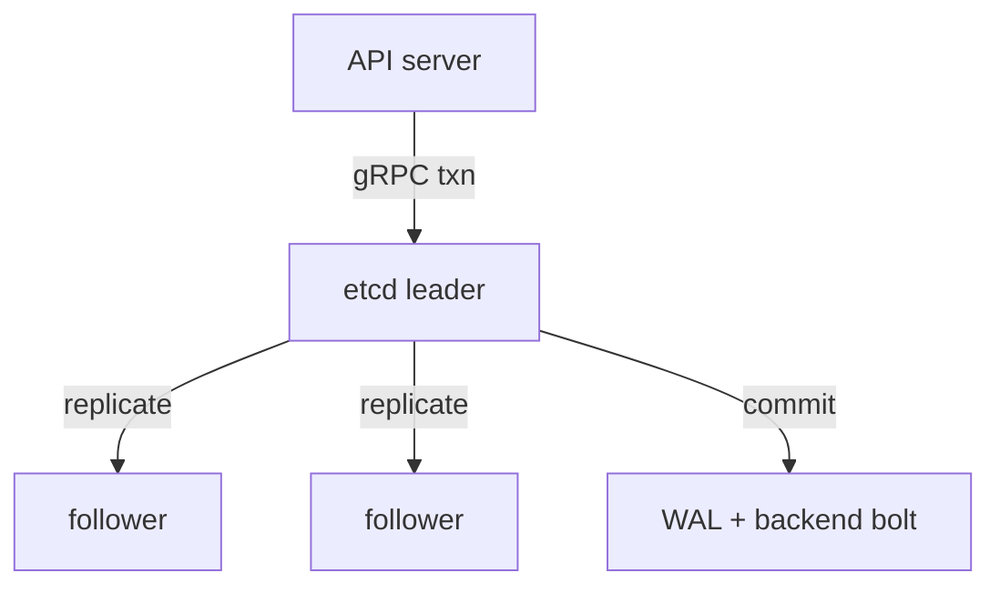

# 17 — etcd deep dive: the notebook behind the librarian

> Prerequisite: [09 — API server & etcd](09-api-etcd.md)

## ELI5 hook

Chapter 09 said etcd is the **notebook**. This chapter opens it: how pages get consensus (Raft), how history is trimmed (compaction), why slow disks feel like a dying cluster, and how to backup/restore without inventing folklore.

## Mental model



| Idea | Meaning |
|------|---------|
| **Raft quorum** | Majority must accept a write; lose quorum → unavailable |
| **Leader** | Only leader serves linearizable writes (typical setup) |
| **WAL** | Write-ahead log — durability before applying |
| **MVCC / revision** | Every change bumps a global revision; watches use it |
| **Compaction** | Drop old revisions so the DB doesn’t grow forever |
| **Defrag** | Reclaim free pages after compaction |

Kubernetes stores objects as keys roughly under `/registry/...`. You almost never touch etcd directly in day-to-day ops — but when you do (backup, restore, performance), this model saves you.

## Raft without the PhD

1. Client proposes a write to the **leader**
2. Leader appends to its log, ships entries to followers
3. When a **majority** has the entry, leader **commits** and applies
4. Followers learn the commit and apply too

Reads can be:

- **Linearizable** (default for many API paths) — see the latest committed state (may go to leader / use quorum read)
- **Serializable / stale** — faster, may lag (API server mostly shields you)

**Odd-sized clusters** (3 or 5) are the norm: tolerate `(n-1)/2` failures.

## What lives on disk

```text
data-dir/
  member/
    wal/          # write-ahead log segments
    snap/         # periodic snapshots
    ...
```

Slow or full disks → heartbeat timeouts → leader elections → **API latency spikes** that look like “Kubernetes is broken.”

### Compaction & Kubernetes

The API server periodically **compacts** etcd so watchers don’t need infinite history. If compaction races a slow watcher, clients get “too old resource version” and must re-LIST. Controllers’ informers handle this; buggy clients may not.

```bash
# On a lab etcd (NOT production tinkering):
# etcdctl endpoint status -w table
# etcdctl endpoint health
# etcdctl compact <revision>
# etcdctl defrag
```

## How Kubernetes uses etcd

| Concern | Practice |
|---------|----------|
| Size | Prefer 8GB+ dedicated SSD; watch DB size alerts |
| Members | 3 or 5; don’t casually add voting learners without a plan |
| Network | Low latency between members; avoid cross-region Raft |
| Auth | etcd peer/client TLS; only API server talks to it |
| Backup | Snapshot regularly; test restore on a throwaway control plane |
| Objects | Huge CR status blobs inflate etcd — keep status lean |

**API server is the only supported writer.** Direct `etcdctl put` on `/registry` is how you create haunted clusters.

## Lab

```bash
./courses/k8s-internals/labs/17-etcd-raft-lab.sh
```

Manual exploration on kind (control-plane static pod):

```bash
# Find etcd
kubectl -n kube-system get pods -l component=etcd -o wide 2>/dev/null || \
  docker exec kind-control-plane ls /etc/kubernetes/manifests

# From inside the control-plane node (kind):
docker exec -it kind-control-plane bash -lc '
  ETCDCTL_API=3 etcdctl \
    --endpoints=https://127.0.0.1:2379 \
    --cacert=/etc/kubernetes/pki/etcd/ca.crt \
    --cert=/etc/kubernetes/pki/etcd/server.crt \
    --key=/etc/kubernetes/pki/etcd/server.key \
    endpoint status -w table
'

# Watch revisions climb as you create objects
kubectl create configmap etcd-lab-$(date +%s) --from-literal=k=v
```

Optional local Raft sandbox (no Kubernetes):

```bash
# If you have etcd on PATH — three members via the lab script
```

## Gotchas

- **Even-sized clusters (2, 4)** — Worse failure math; avoid for voting members.
- **Restoring one member wrong** — Can cause split history; follow versioned restore runbooks.
- **Alarm NOSPACE** — etcd stops writes; free disk, compact, defrag, disarm alarm.
- **fsync latency** — Cloud disks with poor fsync = elections under load.
- **“Just delete the key”** — Use API deletion; dangling ownerRefs and caches will confuse you.

## Checkpoint

etcd = **Raft-replicated MVCC keyspace**. Performance and quorum are control-plane destiny.

Next deep dive: [18 — Controllers & informers](18-controllers-deep.md).

---

**Quiz arc:** deep dives → [`/quizzes/k8s-deep-dives/`](/quizzes/k8s-deep-dives/)
