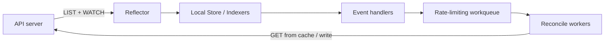

# 18 — Controllers deep dive: informers, workqueues, and level triggers

> Prerequisite: [10 — Controllers](10-controllers.md)

## ELI5 hook

Chapter 10 said controllers **reconcile forever**. This chapter is the factory tour: how they **cache** the API (informers), how they **queue** work without melting the API server, why **level-triggered** design forgives missed events, and how ownerRefs + finalizers create (and sometimes block) deletion.

## Mental model



| Piece | Job |
|-------|-----|
| **Reflector** | LIST, then WATCH; re-LIST on “too old” |
| **DeltaFIFO / Store** | Ordered apply of Added/Updated/Deleted |
| **Indexer** | Query cache by label/field without hitting API |
| **workqueue** | Dedupe keys, rate-limit retries, handle storms |
| **Reconcile** | Read desired + actual → act → requeue on error |

**Edge-triggered** systems act on “the event.” Kubernetes controllers are **level-triggered**: “given current state, drive toward desired.” Missing a watch event is OK; the next sync fixes it.

## Shared informers

Many controllers share one informer factory per resource type:

- One WATCH connection for Deployments, not N
- Memory cost shared
- Stale reads possible for a few seconds — writes still go to API for truth when needed

```text
factory := informers.NewSharedInformerFactory(clientset, resyncPeriod)
podInformer := factory.Core().V1().Pods()
podInformer.Informer().AddEventHandler(...)
factory.Start(stopCh)
factory.WaitForCacheSync(stopCh)
```

**Resync period** periodically re-lists into the queue even without changes — safety net against logic bugs and silent drift.

## Workqueues: the adult supervision

```text
onAdd/Update/Delete → queue.Add(namespace/name)
worker:
  item := queue.Get()
  err := reconcile(item)
  if err != nil { queue.AddRateLimited(item) } else { queue.Forget(item) }
```

| Behavior | Why |
|----------|-----|
| Key dedupe | 1000 updates → one reconcile burst |
| Rate limiting | Back off when the world is on fire |
| Max retries | Poison items eventually drop (with metrics) |

## Owner references & garbage collection

```yaml
metadata:
  ownerReferences:
    - apiVersion: apps/v1
      kind: ReplicaSet
      name: web-7d4c
      uid: ...
      controller: true
      blockOwnerDeletion: true
```

- **Foreground / background / orphan** deletion propagation
- **controller: true** — this owner “controls” the child for adoption logic
- GC deletes dependents when owner disappears (per policy)

### Finalizers

```yaml
metadata:
  finalizers:
    - example.com/drain
```

Deletion sets `deletionTimestamp` but object stays until **all finalizers removed**. Controllers must clear their finalizer after cleanup — or the object sits in `Terminating` forever.

## Leader election

HA controller managers run N replicas; only one **active** leader holds a Lease. Others wait. Pattern: `coordination.k8s.io/v1 Lease`.

## How to debug controller pain

| Symptom | Look at |
|---------|---------|
| Object stuck Terminating | Finalizers; controller logs |
| Flapping fields | Two controllers fighting the same field |
| API 429 / timeouts | Too many uncached LIST; broken informer |
| ProgressDeadlineExceeded | Deployment rollout stalled — RS/Pod events |
| Orphan Pods | Selector/ownerRef mismatch |

## Lab

```bash
./courses/k8s-internals/labs/18-controllers-lab.sh
```

Manual:

```bash
# Watch ownerRefs appear
kubectl create deploy ctrl-lab --image=nginx:1.25-alpine --replicas=2
kubectl get rs -l app=ctrl-lab -o yaml | grep -A8 ownerReferences
POD=$(kubectl get pod -l app=ctrl-lab -o jsonpath='{.items[0].metadata.name}')
kubectl get pod "$POD" -o yaml | grep -A8 ownerReferences

# Finalizer sticky delete (careful — clean up!)
kubectl apply -f - <<'EOF'
apiVersion: v1
kind: ConfigMap
metadata:
  name: sticky
  finalizers:
    - course.k8s.internals/wait
data:
  x: "1"
EOF
kubectl delete cm sticky --wait=false
kubectl get cm sticky -o yaml | grep -E 'deletionTimestamp|finalizers'
# Unstick:
kubectl patch cm sticky --type=json -p='[{"op":"remove","path":"/metadata/finalizers"}]'

kubectl delete deploy ctrl-lab
```

## Gotchas

- **Status vs spec fights** — Use status subresource; don’t have two writers on the same field.
- **Caches lie briefly** — After a write, read-your-writes via API if correctness demands it.
- **Busy loops** — Requeue without backoff = API storm. Always rate-limit errors.
- **Adopted Pods** — Label selectors can steal Pods; understand RS adoption rules.
- **CRD without GC** — Missing ownerRefs → orphaned children after CR delete.

## Checkpoint

Controllers = **informer cache + workqueue + level-triggered reconcile**, with ownership and finalizers for lifecycle.

Next: [19 — CNI deep dive](19-cni-deep.md).

---

**Quiz arc:** deep dives → [`/quizzes/k8s-deep-dives/`](/quizzes/k8s-deep-dives/)
