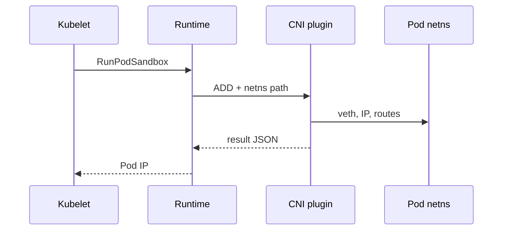

# 19 — CNI deep dive: plugging Pods into the network

> Prerequisite: [12 — Networking](12-networking.md)

## ELI5 hook

Chapter 12 said every Pod gets a phone. **CNI** (Container Network Interface) is the **electrician’s checklist**: given a network namespace path, add an interface, give it an IP, set routes, maybe attach to a bridge or overlay — then tell the runtime “Done, here’s the IP.”

## Mental model

CNI is a **tiny exec plugin contract**, not a daemon API:

```text
CNI_COMMAND=ADD
CNI_CONTAINERID=...
CNI_NETNS=/proc/<pause-pid>/ns/net
CNI_IFNAME=eth0
CNI_PATH=/opt/cni/bin
# stdin: JSON config from /etc/cni/net.d/
```

Plugin prints JSON with IPs, interfaces, routes — or errors on stderr.



| Path | Role |
|------|------|
| `/opt/cni/bin/*` | Plugin binaries (bridge, portmap, firewall, vendor) |
| `/etc/cni/net.d/*.conflist` | Ordered configs kubelet/runtime invoke |
| **Chaining** | Multiple plugins in one conflist (bridge → portmap → …) |

## What Linux does on ADD (bridge example)

1. Create **veth pair**
2. Move one end into pod netns, rename to `eth0`
3. Attach host end to **cni0** bridge
4. Allocate IP from a pool (host-local, dhcp, or IPAM plugin)
5. Configure address + default route in pod netns
6. `lo` up inside netns

Cross-node: either **L2/L3 routing** (BGP, cloud routes) or **overlay** (VXLAN/Geneve) encapsulating pod packets.

### DEL and CHECK

- **DEL** — idempotent teardown (IPAM free, link delete)
- **CHECK** — verify still configured (CNI 1.0+)

Leaked IPs and orphaned veths are classic “CNI bug / crashed midway” symptoms.

## How Kubernetes uses CNI

kubelet asks the runtime to create the **sandbox**; the runtime calls CNI. The reported IP becomes Pod status IP.

| Mode | Idea |
|------|------|
| **Bridge + routes** | Flat L3; cloud route tables or node agent |
| **VXLAN overlay** | Easy everywhere; encapsulation overhead |
| **eBPF dataplane** | Replace much of iptables/kube-proxy (chapter 20) |
| **NetworkPolicy** | Same CNI (or companion agent) enforces filters |

**Kind** often uses kindnet; production may use Calico, Cilium, Antrea, Flannel, cloud VPC CNI, etc. Same CNI contract; different traffic engineering.

### IPAM

Host-local ranges per node, centralized allocators, or cloud ENI/IP assignment. Exhaustion → Pods stuck **ContainerCreating** with CNI errors in events.

## Lab

```bash
./courses/k8s-internals/labs/19-cni-inspect.sh
```

Manual on kind:

```bash
NODE=kind-control-plane   # adjust name
docker exec "$NODE" ls /opt/cni/bin
docker exec "$NODE" ls /etc/cni/net.d
docker exec "$NODE" cat /etc/cni/net.d/*.conflist 2>/dev/null | head -80

# See veths on the host side
docker exec "$NODE" ip -br link | head
docker exec "$NODE" bridge link 2>/dev/null | head || true

# From a Pod: who is my default gateway?
kubectl run cni-lab --image=busybox:1.36 --restart=Never -- sleep 3600
kubectl wait --for=condition=Ready pod/cni-lab --timeout=60s
kubectl exec cni-lab -- ip route
kubectl exec cni-lab -- ip -br addr
kubectl delete pod cni-lab
```

DIY unshare netns + “fake CNI” taste (host Linux):

```bash
sudo ip netns add cni-demo || true
sudo ip link add veth-a type veth peer name veth-b
sudo ip link set veth-b netns cni-demo
sudo ip addr add 10.200.0.1/24 dev veth-a
sudo ip link set veth-a up
sudo ip netns exec cni-demo ip addr add 10.200.0.2/24 dev veth-b
sudo ip netns exec cni-demo ip link set veth-b up
sudo ip netns exec cni-demo ip link set lo up
sudo ip netns exec cni-demo ping -c1 10.200.0.1
sudo ip netns del cni-demo
sudo ip link del veth-a 2>/dev/null || true
```

## Gotchas

- **Multiple conflists** — Lexicographic order; surprise winners.
- **MTU mismatches** — Overlay + lower MTU = mysterious PMTUD pain; set explicitly.
- **HostPort / portmap** — Extra CNI chain; conflicts with host processes.
- **Policy CNI ≠ kube-proxy** — Services still need a dataplane (iptables/IPVS/eBPF).
- **Upgrades** — CNI daemonset + node binary skew breaks ADD.

## Checkpoint

CNI = **exec plugins configuring netns**. Pod IP is an output of that contract, not a kubectl field you invent.

Next: [20 — eBPF dataplane](20-ebpf-dataplane.md).

---

**Quiz arc:** deep dives → [`/quizzes/k8s-deep-dives/`](/quizzes/k8s-deep-dives/)
