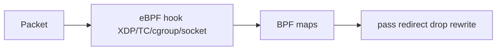

# 20 — eBPF dataplane: services and policy in the kernel

> Prerequisites: [12 — Networking](12-networking.md), [19 — CNI deep dive](19-cni-deep.md)

## ELI5 hook

Classic kube-proxy programs a **giant phone switchboard** (iptables/IPVS) in userspace-managed rules. **eBPF** lets a dataplane (Cilium, Calico eBPF, …) hang **tiny programs on kernel hooks** — “when a packet enters here, look up this map, rewrite, bypass the long rule list.” Same Kubernetes Service/NetworkPolicy *ideas*, different engine room.

## Mental model



| Concept | Meaning |
|---------|---------|
| **eBPF program** | Verified bytecode loaded into the kernel |
| **Map** | Shared key/value (endpoints, policy, conn tracking) |
| **XDP** | Earliest RX path — drop/redirect at wire speed |
| **TC** | Traffic control hooks on interfaces |
| **cgroup/connect** | Influence socket connect() for services |
| **Verifier** | Kernel rejects unsafe programs |

Kubernetes still has Services, Endpoints, NetworkPolicies. The **agent** translates API objects into map updates + attached programs instead of (or in addition to) iptables.

## What Linux does

### Loading a program (conceptual)

```bash
# Observability — list programs/maps (needs bpftool + permissions)
bpftool prog show 2>/dev/null | head
bpftool map show 2>/dev/null | head
```

Programs attach to:

- Network devices (XDP/TC)
- cgroups (network hooks)
- Tracepoints/kprobes (observability — Hubble, tetragon, etc.)

### Why people switch from iptables kube-proxy

| iptables pain | eBPF angle |
|---------------|------------|
| Rule count grows with Services × Pods | O(1)-ish map lookups |
| Conntrack pressure | Smarter / optional paths |
| Hard to introspect | Maps + dedicated observability |
| Sequential rule evaluation | Programmed pipelines |

Not magic: you still need correct **identity** (labels → security identities), MTU, and a healthy agent DaemonSet.

## How Kubernetes uses it

Typical Cilium-style path (simplified):

1. Watch Services / EndpointSlices / NetworkPolicies / Pods
2. Allocate **identity** per label set
3. Program BPF maps for liveness of backends and allow/deny
4. Optionally **disable kube-proxy** — BPF implements ClusterIP/NodePort
5. Hubble observes flows from the same dataplane

```text
Pod A (id=1200) → ClusterIP → map lookup → Pod B IP:port
Pod A → Pod C denied by policy → drop + metric
```

**kube-proxy replacement** is a cluster choice: understand upgrade/rollback before flipping.

### NetworkPolicy semantics still matter

eBPF enforces the *intent*; mislabeled Pods still get the wrong identity. Policy debugging becomes “which identity? which map entry?” not only “which iptables chain?”

## Lab

```bash
./courses/k8s-internals/labs/20-ebpf-observe.sh
```

The lab is **observation-first** (works without installing Cilium): compare classic kube-proxy rules vs detect BPF if present.

```bash
# On a kind node — classic dataplane footprints
NODE=kind-control-plane
docker exec "$NODE" iptables-save 2>/dev/null | grep -E 'KUBE-|cali-' | head -40 || true
docker exec "$NODE" bpftool prog show 2>/dev/null | head || echo "bpftool not in node image"

# If you install Cilium on a disposable kind cluster (optional heavy lab):
# cilium install
# cilium status
# cilium connectivity test
# hubble observe
```

Host Linux (if `bpftool` exists):

```bash
bpftool feature probe 2>/dev/null | head -30 || true
ls /sys/fs/bpf 2>/dev/null || true
```

## Gotchas

- **Kernel version** — Features need recent-enough kernels; managed node images vary.
- **Mixing kube-proxy + eBPF** — Dual dataplanes can conflict; follow vendor mode docs.
- **HostNetwork / privileged** — Bypass or complicate identity/policy.
- **Debugging with only iptables muscle memory** — Wrong tool; use vendor CLI + bpftool.
- **eBPF ≠ CNI alone** — Often one product does CNI + policy + service routing together.

## Checkpoint

eBPF dataplanes move Service/policy enforcement into **kernel programs + maps**, trading iptables sprawl for verifier-constrained speed and new observability.

Next: [21 — CSI deep dive](21-csi-deep.md).

---

**Quiz arc:** deep dives → [`/quizzes/k8s-deep-dives/`](/quizzes/k8s-deep-dives/)
