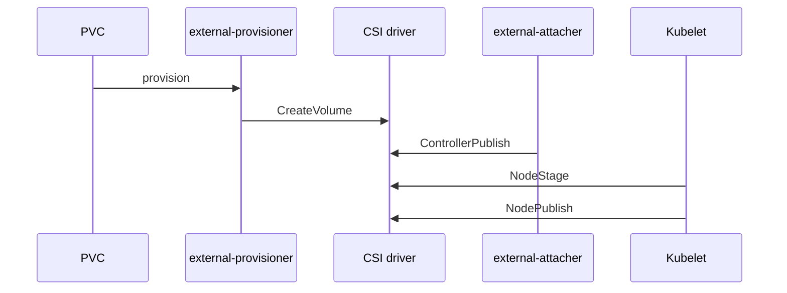

# 21 — CSI deep dive: attach, mount, and the sidecar circus

> Prerequisite: [14 — Storage](14-storage.md)

## ELI5 hook

Chapter 14 said CSI is the **moving company**. This chapter is the warehouse tour: which workers do **CreateVolume**, which do **ControllerPublish** (attach), which do **NodeStage/NodePublish** (mount into the Pod), and why Kubernetes runs a **sidecar band** next to every driver.

## Mental model

CSI splits responsibilities:

| RPC / step | Where | Meaning |
|------------|-------|---------|
| **CreateVolume / DeleteVolume** | Controller | Provision/delete the disk/share |
| **ControllerPublish / Unpublish** | Controller | Attach/detach to a **node** |
| **NodeStage** | Node | Format/mount to a global host path once |
| **NodePublish** | Node | Bind-mount into the Pod’s mount namespace |
| **NodeUnpublish / Unstage** | Node | Reverse on teardown |



**VolumeAttachment** API objects track attach state. Stuck attachments = Pods pending with `FailedAttachVolume` / `TimedOut`.

## The sidecar circus (why so many containers?)

Out-of-tree drivers ship as Deployments/DaemonSets with helper containers:

| Sidecar | Job |
|---------|-----|
| **external-provisioner** | Watch PVC → call CreateVolume → bind PV |
| **external-attacher** | Watch VolumeAttachment → ControllerPublish |
| **external-resizer** | PVC size ↑ → ControllerExpand + NodeExpand |
| **external-snapshotter** | VolumeSnapshot → CreateSnapshot |
| **node-driver-registrar** | Tell kubelet the driver socket exists |
| **livenessprobe** | Restart unhealthy driver |

The **driver** implements gRPC CSI; sidecars implement Kubernetes glue so every vendor doesn’t rewrite the same controllers.

## What Linux does on the node

After attach, the block device (or NFS) appears on the node. Then:

1. **NodeStage** — mount to `/var/lib/kubelet/plugins/kubernetes.io/csi/...` (global)
2. **NodePublish** — bind into `/var/lib/kubelet/pods/<uid>/volumes/kubernetes.io~csi/...`
3. That path is bind-mounted into the container mount namespace at `volumeMounts.mountPath`

```bash
# On a node with a mounted CSI volume (names vary):
find /var/lib/kubelet/pods -name 'mount' 2>/dev/null | head
mount | grep -i csi | head
```

**ReadWriteOnce** attach is per-node: scheduler + attacher must agree. Multi-attach errors mean two nodes fighting one RWO volume.

## Topology & scheduling

StorageClasses can set **WaitForFirstConsumer** so the volume is provisioned in the zone where the Pod actually schedules — avoiding “disk in zone A, Pod in zone B.”

```yaml
volumeBindingMode: WaitForFirstConsumer
allowedTopologies: ...
```

## Lab

```bash
./courses/k8s-internals/labs/21-csi-inspect.sh
```

Manual:

```bash
kubectl get csidrivers
kubectl get csinodes -o wide
kubectl get storageclass
kubectl get volumeattachment

# Dynamic PVC lifecycle (needs a default StorageClass — kind usually has one)
kubectl apply -f - <<'EOF'
apiVersion: v1
kind: PersistentVolumeClaim
metadata:
  name: csi-lab-pvc
spec:
  accessModes: ["ReadWriteOnce"]
  resources:
    requests:
      storage: 100Mi
---
apiVersion: v1
kind: Pod
metadata:
  name: csi-lab-pod
spec:
  containers:
    - name: app
      image: busybox:1.36
      command: ["sh", "-c", "echo hi > /data/x; sleep 3600"]
      volumeMounts:
        - name: data
          mountPath: /data
  volumes:
    - name: data
      persistentVolumeClaim:
        claimName: csi-lab-pvc
EOF

kubectl wait --for=condition=Ready pod/csi-lab-pod --timeout=120s || \
  kubectl describe pod csi-lab-pod | tail -40
kubectl get pvc csi-lab-pvc
kubectl get volumeattachment
kubectl exec csi-lab-pod -- cat /data/x
kubectl delete pod csi-lab-pod pvc csi-lab-pvc
```

## Gotchas

- **Stuck Terminating PVC/Pod** — VolumeAttachment or finalizers; don’t force-delete blindly in prod.
- **Expand without ExpandCSIVolumes** — Feature/driver/sidecar must all support resize.
- **Snapshots ≠ backups** — Crash-consistent ≠ application-consistent; know your DB story.
- **Privileged node plugins** — Drivers often need elevated privileges; audit them.
- **Filesystem vs Block** — `volumeMode: Block` skips FS mount; apps must handle raw devices.

## Checkpoint

CSI = **gRPC driver + Kubernetes sidecars** implementing provision → attach → stage → publish into Linux mount namespaces.

You now have book-depth on etcd, controllers, CNI, eBPF, and CSI.

---

**Quiz:** [`/quizzes/k8s-deep-dives/`](/quizzes/k8s-deep-dives/)

**Milestone:** pass deep dives + the five core K8s quizzes → **Cluster Scholar**.

Back to the [syllabus](00-README.md).
